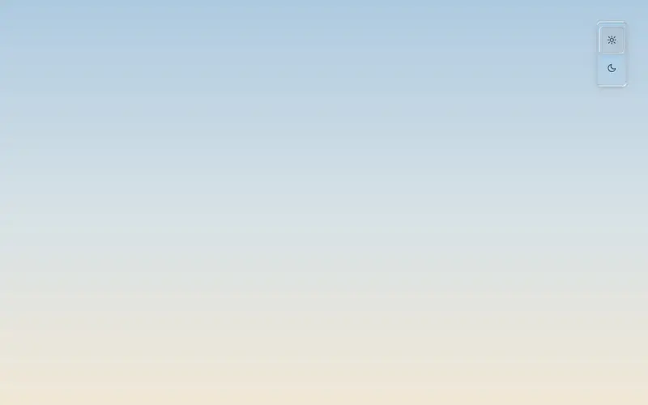
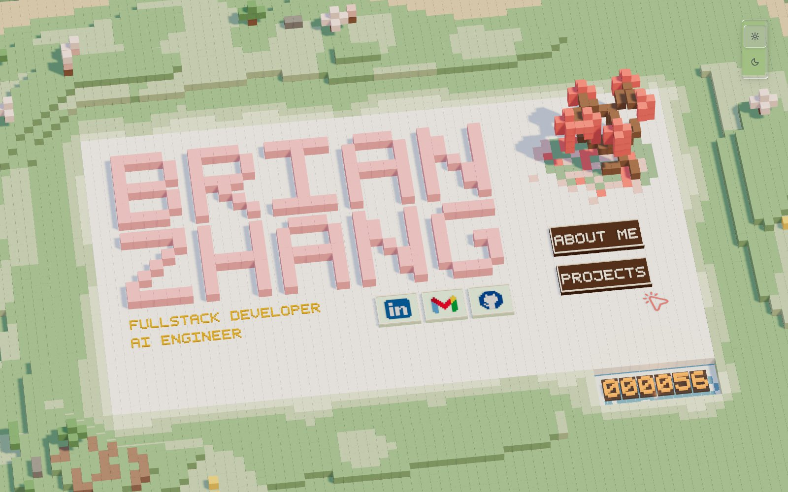
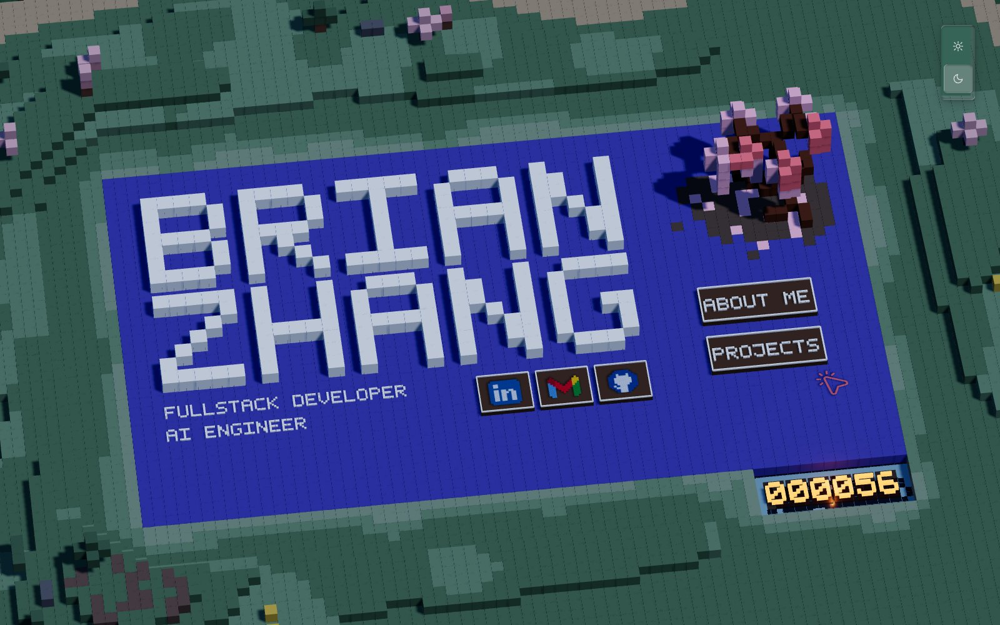
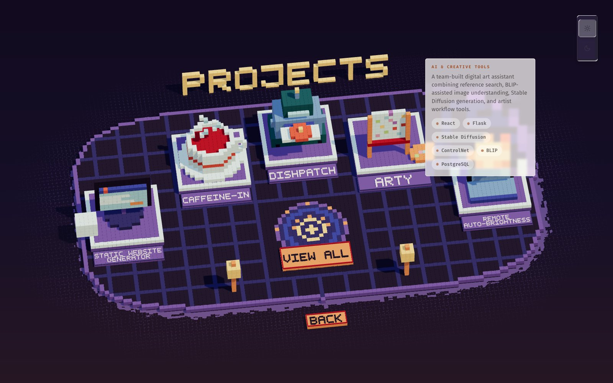
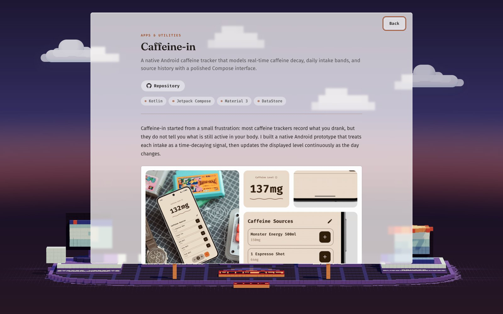
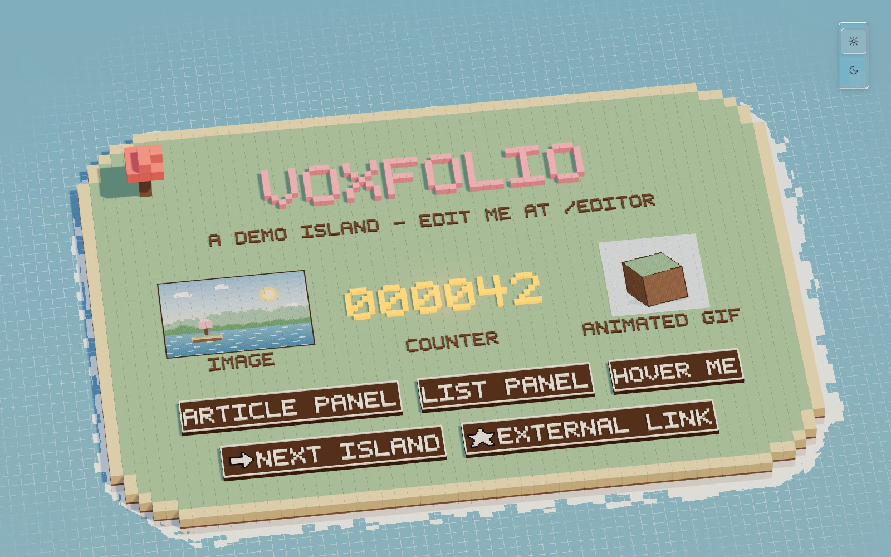
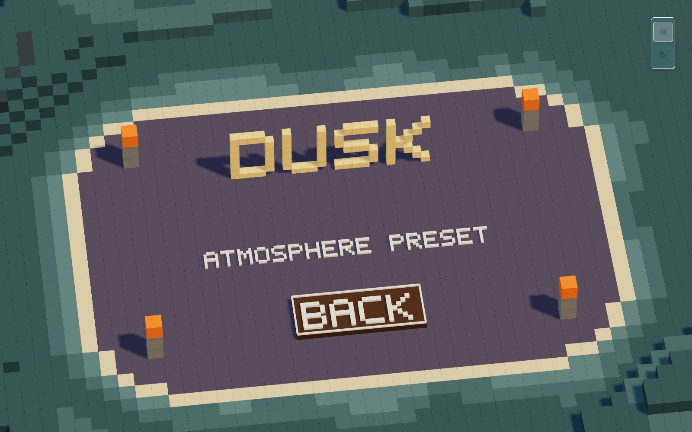
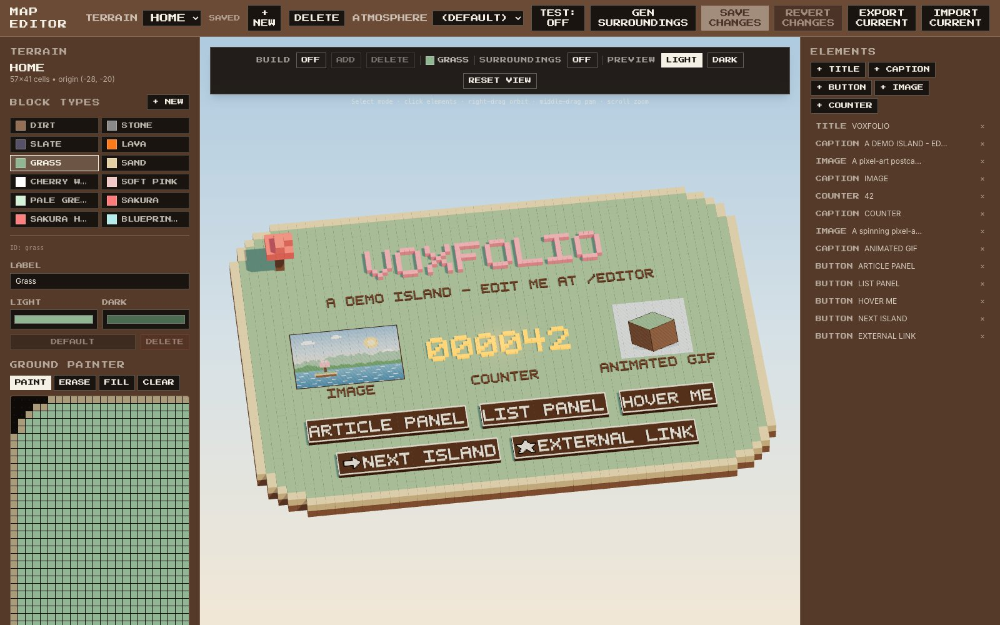

# voxfolio

Welcome to voxfolio~

This is the framework behind [my personal portfolio](https://brian-pz.vercel.app), and I've decided to open-source it.

Full disclosure: although the idea and the system architecture design are mostly done by me, most of the code implementation was by AI.



## See it in action

My portfolio runs on voxfolio: **[brian-pz.vercel.app](https://brian-pz.vercel.app)**

| | |
| --- | --- |
|  |  |
| The home island: voxel title, icon buttons, a Nixie counter, and generated surroundings | Same island, one click on the light/dark switch |
|  |  |
| A second terrain with its own dusk mood, plus a hover card | A project opened in the frosted-glass reading panel |

### What you start with

Clone this repo and you get a demo island where every button is named after the feature it shows off:



- **ARTICLE PANEL** opens a panel section, a single MDX file (`content/article.mdx`). On a personal site, this is your "About me".
- **LIST PANEL** opens a list section, a folder of MDX files grouped into cards (`content/list/`). On a personal site, these are your projects or posts.
- **HOVER ME** shows a hover card for one list item, and clicking it opens that item directly.
- **NEXT ISLAND** swaps the whole scene to a second terrain, `dusk`, in place.
- **EXTERNAL LINK** opens a URL in a new tab. It and NEXT ISLAND also show icon images on buttons.
- **IMAGE**, **ANIMATED GIF** and **COUNTER** are standalone elements, and the pink tree in the corner is blocks built upward in the 3D editor.

| | |
| --- | --- |
|  |  |
| The `dusk` island: an atmosphere preset, an upright title, lantern pillars built from blocks, and generated surroundings | The map editor at `/editor` |

## Features

- **Voxel island homepage.** Terrain, voxel text, button labels, counter digits and generated surroundings are rendered as instanced voxels; image elements are textured planes. The island grows in with a radial reveal when the page loads.
- **Visual map editor** at `/editor`. You can paint the ground, build upward in 3D, place and style elements, and manage block colors. During development, changes save straight to JSON files in `data/`.
- **MDX content in overlays.** Single-page panels and grouped lists (projects, posts and so on) open in an animated "mosaic glass" reading surface, and the camera reframes the island below it.
- **Multiple terrains.** A button can swap the scene to another island in place, with a radial transition and a camera move.
- **Hover cards.** A button can show a card for a list item (category, summary, tech tags) when you hover over it.
- **Light and dark themes** for the whole scene and the reading surface. Visitors can switch themes for the current visit.
- **Atmosphere presets.** A terrain can have its own sky, water and surroundings palette. One preset, "Dusk", is included.
- **Generated surroundings.** One click grows a coastline, beach, hills and trees around your island from a random seed.
- **Nixie counter.** Glowing digits that show a fixed number, or a count loaded from any JSON endpoint you provide.
- **Mixed reality.** On a WebXR headset, a "View in your space" button places the island on a virtual table: passthrough AR where the device supports it, otherwise VR. Content opens in a reading panel inside the scene.
- **Lightweight.** The canvas only re-renders when something changes, voxels are drawn with instanced meshes, and the XR code is split out of the initial bundle (the performance HUD loads only when you ask for it).

## Quick start

Requires Node.js 18.18 or newer.

```bash
npm install
npm run dev
```

- http://localhost:3000 is the site.
- http://localhost:3000/editor is the map editor.

Or deploy your own copy straight away:

[](https://vercel.com/new/clone?repository-url=https%3A%2F%2Fgithub.com%2Fthat1potato%2Fvoxfolio&project-name=voxfolio&repository-name=voxfolio)

The demo includes two islands, `home` and `dusk`, plus sample content for one panel section and one list section (see [What you start with](#what-you-start-with)).

Other scripts: `npm run build`, `npm start`, `npm run lint`, `npm run typecheck`, and `npm run dev:https` (see [Mixed reality](#mixed-reality)).

## Make it yours

### 1. Name and sections: `site.config.ts`

```ts
export const site = {
  name: "Voxfolio",        // page <title> and PWA manifest name
  description: "…",        // meta description and manifest description
};

export const sections: Section[] = [
  { id: "article", label: "ARTICLE PANEL", kind: "panel" },
  { id: "list",    label: "LIST PANEL",    kind: "list"  },
];
```

For a portfolio you'd probably rename these to something like `{ id: "about", label: "ABOUT", kind: "panel" }` and `{ id: "projects", label: "PROJECTS", kind: "list" }`. Rename the content file and folder to match, and update the buttons in `/editor`.

- A section's `id` is also the name of its content file or folder, and it's what a button's content action points to. `label` is the header of a list overlay.
- The large 3D title on the island is not `site.name`. It's a `title` element on the terrain, which you edit in `/editor`.
- The `palette` export at the bottom of the file holds the shared UI colors. Tailwind and the default 3D text and button colors read it, so keep the export when you edit it.

### 2. Content: `content/`

| Section kind | Files | Shown as |
| --- | --- | --- |
| `panel` | `content/<id>.mdx` | A single article |
| `list` | `content/<id>/*.mdx` | Cards grouped by category. Clicking a card opens the item, and Back returns to the list |

A panel reads one frontmatter field, `title`. If it's missing, the section label is used.

List items can use any of these frontmatter fields, all optional:

```yaml
---
title: Sample Item                             # defaults to the file name
date: "2025-06-01"                             # YYYY-MM-DD; lists sort newest first
summary: One line about it.                    # card text, article lede, hover card
category: Demo                                 # group heading and eyebrow; items without one go under "Other", listed last
tech: ["TypeScript", "React"]                  # tag pills in the article header and hover card
repo: https://github.com/your-name/sample-item   # button in the article header
demo: https://example.com                      # button in the article header
---
```

An item's slug is its file name without `.mdx`.

Missing content doesn't break the site. A panel with no file shows a hint to add `/content/<id>.mdx`, and an empty list shows a hint to add files to its folder.

MDX is Markdown with GFM (tables, task lists, strikethrough, autolinks). You can use these three components without importing them:

| Component | Props |
| --- | --- |
| `<Figure>` | `src` (required), `alt`, `caption`, `width` (a CSS max width, e.g. `"420px"` or `"60%"`) |
| `<YouTube>` | `id` (required; the part after `v=`), `title` |
| `<Video>` | `src` (required), `poster` |

```mdx
<Figure src="/samples/voxel-cube.png" alt="A voxel island" caption="Images live in public/." width="420px" />

<YouTube id="VIDEO_ID" title="Project demo" />

<Video src="/clips/demo.mp4" poster="/clips/demo.jpg" />
```

- Put images and videos in `public/` and reference them with root-relative paths.
- Links that start with `http` open in a new tab. Other links go through Next.js `<Link>`. voxfolio has no page per content item, so don't link to routes like `/projects/…`.
- Write component attributes as double-quoted strings (`width="420px"`, not `width={420}`) so the XR reading panel can read them too.

The demo content is safe to delete or replace: `content/article.mdx`, `content/list/*.mdx`, and the images, GIF and icons in `public/samples/`. The demo islands are `data/terrains/home.json` and `data/terrains/dusk.json` (plus `data/generated-surroundings/dusk.json`).

**To add a section:**

1. Add an entry to `sections`.
2. Create `content/<id>.mdx` (for a panel) or the folder `content/<id>/` (for a list).
3. In `/editor`, add a button (or select an existing one) and set its action to that content section.

### 3. The island: `/editor`

Run `npm run dev` and open http://localhost:3000/editor.

Edits stay in your browser until you click **Save Changes** (or press Ctrl/Cmd+S).

- Saving writes `data/block-types.json` and the current terrain's `data/terrains/<id>.json`. A new terrain is also added to `data/terrains/index.json`.
- Reloading the page throws away unsaved edits.
- If you switch away from a terrain with unsaved edits, the editor asks whether to save, discard or cancel.
- **Revert Changes** goes back to the last save.

**Top toolbar**

- Terrain picker, **+ New** and **Delete**. The root terrain can't be deleted.
- **Atmosphere** sets the preset for the current terrain (see [Atmospheres](#atmospheres)).
- **Test: OFF/ON** controls what a click does:
  - When OFF, clicking an element selects it for editing.
  - When ON, buttons act the way they do on the live site: terrain switches and links work. Content-section buttons do nothing here, because the reading overlay only exists on the home page.
- **Gen Surroundings** generates surroundings for the current terrain (see [Generated surroundings](#generated-surroundings)).
- **Export Current** and **Import Current** move one terrain's JSON in and out of the editor, for example to or from other tools. An imported file must have the same `id` as the current terrain.

**Ground painter**

- It shows the `y = 0` layer as a flat grid, with north at the top.
- **Paint** and **Erase** work by dragging with the selected block type. **Fill** and **Clear** apply to the whole layer.
- The grid resizes to fit what you paint, plus a 3-cell margin.

**3D viewport**

- **Build: On**, then **Add** or **Delete**. Left-click a block face to place a block of the selected type, or to remove that block. Blocks on layers `y >= 0` can be edited.
  - Elements are hidden while you build, unless you turn on **Elements**.
- **Surroundings** shows or hides the water and generated surroundings. It's off by default in the editor.
- **Preview light / dark** switches the preview between palettes without changing the site's default.
- Right-drag to orbit, middle-drag to pan, and scroll to zoom. **Reset View** returns to the live site's framing.

**Elements**

- **+ Title**, **+ Caption**, **+ Button**, **+ Image** and **+ Counter** add an element at the island's center.
- Selecting an element lets you edit:
  - its text (press Enter for a new line)
  - position, scale and rotation
  - orientation: `ground` lies flat and `upright` stands up
  - light and dark colors (**Use defaults** removes your overrides)
- Titles, captions and buttons can also carry an attached image.
- Voxel text supports A–Z, a–z, 0–9, spaces and `. , - / ! ?`. Any other character shows as a space.

**Buttons**

A button's action is one of the following, or none:

- **Target terrain**: switch to another terrain in place.
- **Content section**: open a section's overlay. Set **Content item slug** as well to open one list item directly.
- **Hyperlink**: an `https:` link (opens in a new tab) or a `mailto:` link.

Buttons have a few more settings:

- **Hover card → item** shows a list item's card when you hover over the button. It's saved as `hoverCardItem: "<sectionId>/<itemSlug>"`, for example `"list/sample-item"`. Hover cards appear only on the live site, not in the editor preview or in XR.
- **Content** can be a caption, an image, or both, with padding.
- Width and depth set the button's size.

**Images**

- An image source can be a root-relative path or an `https:` URL.
- During `npm run dev` you can upload PNG, JPEG, GIF, WebP, AVIF or SVG files up to 10 MiB. They're saved to `public/map-assets/`. SVGs are checked, not cleaned: an SVG is rejected if it contains scripts, event-handler attributes, DOCTYPE/ENTITY declarations, embedded content (foreignObject/iframe/object/embed) or external references.
- GIFs play as animations.
- Standalone images can stick to a block face with **Pick surface**.

**Block types**

- **+ New** adds a block type (the editor asks for an id and a label).
- Each type has a label and separate light and dark colors.
- **Make Default** picks the block type that new terrains are filled with and that the editor selects when it opens.
- **Delete** only works for a type that no terrain uses, that isn't the default, and that isn't the last one left.

#### Terrain files

The editor writes plain JSON, so you can also edit the files by hand.

- **`data/terrains/index.json`**: `{ "version": 2, "rootTerrainId": "home", "terrainIds": ["home", "dusk"] }`. The root terrain loads first. Every id in `terrainIds` needs a matching `data/terrains/<id>.json`.
- **A terrain file** has these fields:
  - `id`: must match the file name. Use lowercase letters, digits and single hyphens, and don't use `index`.
  - `label`
  - `atmosphere` (optional)
  - `grid`
  - `elements`
- **`grid`**:
  - `width` and `depth`: whole numbers from 1 to 200.
  - `originX` and `originZ`: where the grid starts in the world.
  - `layers`: each layer has a unique whole-number `y`, which can be negative, for example a dirt base below the waterline. It also has `masks`, with one entry per block type. Each mask is `depth` strings of `width` characters, each `0` or `1`, and cell `(i, j)` of layer `y` is the block at world position `(originX + i, y, originZ + j)`. Row 0 is north.
  - Masks in the same layer can't overlap, and each mask needs at least one `1`.
- **Elements**:
  - Every element needs a unique `id`, a `type` (`title`, `caption`, `button`, `image` or `counter`), a `position` `[x, y, z]` and an `orientation` (`"ground"` or `"upright"`).
  - `rotationY` is in radians. The editor shows it in degrees.
  - World axes: +X is east, +Z is south (toward the camera), and +Y is up.
- **Buttons**:
  - Use at most one of `targetTerrainId`, `contentSectionId` and `href`. `contentItemSlug` only works together with `contentSectionId`.
  - `href` must start with `https:` or `mailto:`.
  - Image sources must be root-relative or `https:`.
- **Validation** doesn't check that `targetTerrainId`, `contentSectionId` or `hoverCardItem` point to something that exists. Keep those in sync yourself.

If a file breaks these rules, the page fails to load with an error that describes the problem. Saving from the editor checks the whole map first.

## Counter element

A counter shows a number as glowing, zero-padded digits. Add one in `/editor` with **+ Counter**, then set:

- **Digits**: 1–12. Default 6. If the number is longer, only its last digits are shown.
- **Value**: a fixed whole number, 0 or more. Default 0.
- **Endpoint** (optional): a root-relative path or an `https:` URL that returns JSON `{ "count": number }`.

The endpoint is fetched once per page load; counters that use the same URL share one request. If the response arrives, its count replaces **Value**. If the request fails, the counter keeps showing **Value**. The editor preview fetches it too. An endpoint on another domain needs to send CORS headers.

voxfolio doesn't include a counter backend. Here is an example of one you could add yourself. It isn't part of the template:

```ts
// app/api/count/route.ts (an example you'd write yourself)
import { NextResponse } from "next/server";

export const dynamic = "force-dynamic";

// Stand-in store: this number resets whenever the server restarts and isn't
// shared between serverless instances. Swap in a KV store, a database row,
// or a call to another API.
let count = 0;

export async function GET() {
  count += 1; // the counter fetches once per page load, so this counts page loads
  return NextResponse.json({ count });
}
```

Then set the counter's **Endpoint** to `/api/count`.

## Atmospheres

An atmosphere preset gives a terrain its own mood in both light and dark mode. It replaces:

- the sky gradient behind the scene
- the water colors
- the palette of generated surroundings

Terrains without an atmosphere use the default light and dark look.

To use a preset, pick it from the **Atmosphere** menu in the editor toolbar, or add `"atmosphere": "dusk"` to the terrain's JSON. The sky and water update right away. The surroundings palette only applies the next time you click **Gen Surroundings**, because the colors are stored in the generated file.

To add a preset, add an entry to `atmospheres` in `atmosphere.config.ts`. It then appears in the editor menu:

```ts
export const atmospheres: Record<string, AtmospherePreset> = {
  dusk: { /* included */ },
  dawn: {
    label: "Dawn",
    sky:   { skyTop: "#8fb3d9", skyMid: "#f2c6b4", skyBottom: "#f7dcb4" },
    water: { base: "#7fa6c4", foam: "#fff4e6", horizon: "#f7dcb4" }, // horizon = skyBottom
    // Optional. Partial overrides of the surroundings palette.
    surroundings: {
      grass: { light: "#9cc08a", dark: "#9cc08a" },
    },
  },
};
```

- Keep `water.horizon` equal to `sky.skyBottom` so distant water blends into the sky.
- Preset ids use lowercase letters, digits and hyphens.
- If a terrain names an id that isn't in the config, it falls back to the default look.
- The surroundings palette keys are `grass-edge`, `grass-mid`, `grass`, `cliff`, `rock`, `sand`, `seabed`, `trunk`, `leaf`, `blossom`, `blossom-light` and `flower`.

## Generated surroundings

**Gen Surroundings** in the editor builds a decorative ring around the current terrain: a coastline, beach, sloping seabed, rolling hills with cliffs, and trees, rocks and flowers. Each click uses a new random seed.

- The result is written straight to `data/generated-surroundings/<id>.json`. This happens outside the Save/Revert flow.
- The output fits the terrain's current size. If you change the island's footprint, generate again.
- Surroundings are optional. Without them the island sits on open water.
- The default colors live in `lib/surroundings/generate.ts`. An atmosphere's `surroundings` palette overrides them.

## Theme

| File | Controls |
| --- | --- |
| `theme.config.ts` | `activeMode`: the mode the site loads in (`"light"` or `"dark"`). The sun/moon switcher lets a visitor change it for the current visit; the choice isn't saved. |
| `article.config.ts` | The reading surface: fonts, corner radius, max width, mosaic-glass block size, motion, typography, and light/dark colors and glass effects. These become CSS variables that `app/article.css` uses. |
| `components/map/voxel-backdrop.config.ts` | The default sky gradient for each mode, drawn with CSS behind the canvas. |
| `components/map/water.config.ts` | The default water base, foam and horizon colors for each mode. Keep `horizon` equal to the sky's `skyBottom`. |
| `components/map/scene-lighting.config.ts` | Ambient, hemisphere, sun and rim lights, and exposure, for each mode. |
| `data/block-types.json` | Light and dark color for each block type. Edit them in `/editor`. |
| `lib/map-element-appearance.ts` | Default colors for text, buttons and counters. Individual elements can override them in `/editor`. |
| `components/map/text/typography.ts` | Voxel text sizes for titles, button labels, captions and counter digits. |
| `site.config.ts` `palette` | UI colors for the editor and Tailwind, plus the default cream color of voxel text. |

## Mixed reality

- **Who sees it.** The "View in your space" button appears beside the theme switcher only when `navigator.xr` reports that immersive sessions are supported. Desktop visitors never see it. The XR code is kept out of the initial bundle: it loads in a separate async chunk after the page renders, and `<XR>` stays inert until a session starts.
- **Which mode.** The button tries passthrough AR (`immersive-ar`, e.g. Meta Quest) first and falls back to VR (`immersive-vr`, e.g. Safari on Apple Vision Pro and other VR headsets).
- **In a session:**
  - The island shrinks onto a virtual table about 1.2 m across, placed in front of you.
  - Drag the bar under the island to move it, and the knob to resize it (0.3× to 2.5×).
  - Buttons respond to controller rays and hands.
  - Content opens in a reading panel that floats above the island.
  - AR hides the sky and fades the water out into your room. VR draws a gradient sky in the terrain's colors.
- **Testing on your computer.** Install the Immersive Web Emulator browser extension. It adds `navigator.xr` to a desktop browser, so the button appears on `localhost`. @react-three/xr's built-in emulator is disabled on purpose: it bundles a second copy of Three.js.
- **Testing on a headset.** WebXR needs HTTPS.
  - `npm run dev:https` runs `next dev --experimental-https`, which creates a self-signed certificate in `certificates/` (gitignored).
  - Open `https://<your computer's LAN IP>:3000` on the headset and accept the certificate warning.
  - Or deploy the site and test the HTTPS URL.
- **Previewing the reading panel.** During development, `/dev/xr-panel?section=<id>&slug=<slug>` shows the in-headset reading panel in a normal browser tab.

Limitations:

- The XR reading panel draws text from prebuilt font atlases in `public/fonts/msdf/`. They cover printable ASCII plus a few accented letters and punctuation marks, so other scripts don't render in XR. To change the XR fonts or characters, see `public/fonts/msdf/README.md`.
- The panel converts MDX with a simple line-by-line parser:
  - `<Figure>` and Markdown images become images, and `<YouTube>` becomes a poster card.
  - Fenced code blocks, `<Video>` and any other components are dropped.
  - Headings smaller than `###` and blockquotes appear as plain text, `#` and `>` included.
  - Nested lists are flattened.
  - Only double-quoted attributes are read.
- In XR, images hosted on other domains need CORS headers. Images in `public/` always load.
- Hover cards don't appear in XR.

## Performance notes

- **Instancing.** Terrain, voxel text and surroundings each render through `InstancedVoxels`, which draws one `InstancedMesh` per batch. If you add something with many cubes, batch it the same way instead of creating one mesh per cube.
- **On-demand rendering.** The canvas uses `frameloop="demand"`, so it only re-renders when something calls `invalidate()` (from `useThree`). Anything you add that changes the scene has to call `invalidate()`, every frame until it settles if it animates. Otherwise the change won't appear.
- **Perf HUD.** Add `?perf` to any URL, or set `NEXT_PUBLIC_PERF=1`, to show an r3f-perf overlay with draw calls, triangles and fps. It's loaded dynamically.
- **Bundle treemap.** Run `ANALYZE=1 npm run build`.
- **Code splitting.** The XR session layer and XR store load in async chunks outside the initial bundle (fetched after the page renders). The XR reading panel and grab handles load only inside a session, and the perf HUD only with `?perf`.

## The editor in production

`/editor` returns 404 in production builds. To serve it anyway, set `NEXT_PUBLIC_ENABLE_EDITOR=1` before you run `npm run build`; the value is baked in at build time. See `.env.local.example`.

Even then, every write (saving, generating surroundings, uploading images, deleting a saved terrain) only works under `npm run dev`. The API routes refuse writes in production and the matching buttons are disabled. So a production editor is only good for looking around, making edits that stay in the browser, and **Export Current**.

## Deploy

voxfolio is a standard Next.js 15 app with no required environment variables or external services.

- Deploy it to Vercel (import the repository and keep the defaults), or to any Node host with `npm run build && npm start`.
- The island and content are files. The server reads `data/` and `content/` when it renders pages, and nothing is written in production. To publish a change, edit locally with `npm run dev`, commit, and redeploy.
- If you enable the production editor on a serverless host, check that `data/` is included in the deployment, because `/editor` reads it on every request.

## Project structure

```
app/
  page.tsx                   Home: loads terrains and MDX, renders the shell
  layout.tsx                 Fonts, metadata, the shared mosaic-glass SVG filter
  globals.css                Scene, sky backdrop, theme-switcher and XR-button styles
  article.css                Reading-surface and hover-card styles
  manifest.ts, icon.svg, apple-icon.tsx
  editor/                    /editor (404 in production unless enabled)
  api/editor/                Dev-only write routes: save map, delete terrain, surroundings, uploads
  dev/xr-panel/              Dev-only preview of the XR reading panel
components/
  map/                       The 3D scene (VoxelMap and friends), XR layer, look-and-feel configs
  editor/                    Map editor UI
  menu/                      Home shell, reading overlay, theme switcher, XR entry button
  article/                   Reading-surface building blocks
  mdx/                       MDX renderer and <Figure>/<YouTube>/<Video>
content/                     Your MDX (demo content included)
data/
  block-types.json           Paintable block types and their colors
  terrains/index.json        Terrain manifest (root terrain and order)
  terrains/<id>.json         One terrain per file
  generated-surroundings/    Output of Gen Surroundings, one file per terrain
lib/                         Terrain types and validation, editor store, content loader, XR store, …
public/
  fonts/msdf/                Font atlases for the XR reading panel (see its README)
  map-assets/                Images uploaded from the editor
  samples/                   Demo images, GIF and button icons
docs/                        README screenshots, hero animation, social preview image
scripts/generate-msdf-fonts.sh   Rebuilds the XR font atlases
site.config.ts               Site name and description, sections, UI palette
atmosphere.config.ts         Atmosphere presets
theme.config.ts              Default light/dark mode
article.config.ts            Reading-surface design tokens
```

## Credits and licensing

- **Code:** MIT. See [`LICENSE`](./LICENSE).
- **Demo images:** the pixel art in `public/samples/` (postcard, spinning-cube GIF, icons, voxel cube) was made for this repo. Use it however you like.
- **XR font atlases:** the MSDF atlases in `public/fonts/msdf/` are made from Fira Sans, Fira Code and Fraunces, which are licensed under the SIL Open Font License 1.1. The copyright notices and license text are in [`public/fonts/msdf/OFL.txt`](./public/fonts/msdf/OFL.txt).
- **Web fonts:** Press Start 2P, VT323, Inter, Fira Sans, Fira Code and Fraunces are downloaded from Google Fonts by `next/font` at build time and served by the site itself. They're also under the SIL OFL.
- **Built with:** [Next.js](https://nextjs.org), [React Three Fiber](https://r3f.docs.pmnd.rs), [drei](https://github.com/pmndrs/drei), [@react-three/xr](https://github.com/pmndrs/xr), [@react-three/uikit](https://github.com/pmndrs/uikit), [Three.js](https://threejs.org), [Tailwind CSS](https://tailwindcss.com), [next-mdx-remote](https://github.com/hashicorp/next-mdx-remote), [zustand](https://github.com/pmndrs/zustand), [gifuct-js](https://github.com/matt-way/gifuct-js) and [r3f-perf](https://github.com/utsuboco/r3f-perf).
